# 🐾 Animetrix – Technology for Every Paw

### A Technology-Driven Initiative for Urban Animal Welfare

<p align="center">
  <strong>Building awareness. Encouraging community participation. Supporting urban animal welfare.</strong>
</p>

---

## 🌍 About the Project

**Animetrix** is an academic web development project designed to address challenges related to urban animals through technology, community participation and data-driven insights.

The platform focuses on urban animal observations, available infrastructure, community reporting and awareness.

Its purpose is to create a digital space where people can explore animal-related concerns, share observations and understand the facilities and challenges affecting animals in urban environments.

## 🎯 Problem Statement

Urban animals face several challenges, including limited access to basic facilities, infrastructure-related difficulties and a lack of organised community awareness.

Information about these challenges is often scattered.

Animetrix aims to bring relevant information, community observations and awareness together through a technology-driven platform.

## 🎯 Project Objectives

- Encourage awareness of urban animal-related issues.
- Provide a platform for recording animal observations.
- Collect community responses through surveys.
- Highlight available animal-related infrastructure and facilities.
- Present organised information and insights about local challenges.
- Promote community participation and responsible awareness.

## ✨ Key Features and Sections

| Section | Description |
|---|---|
| Home | Introduction to the Animetrix initiative. |
| Explore | Explore urban animal-related information. |
| Report | Submit observations and information about animal-related concerns. |
| Survey | Provide community feedback and responses. |
| Community | Encourage community participation. |
| Insights | Present information and observations in an organised manner. |
| About | Learn about the project and its objectives. |
| Admin | Administrative section of the application. |

## 🛠️ Technologies Used

| Technology | Purpose |
|---|---|
| Angular | Frontend application development |
| TypeScript | Application programming |
| HTML5 | Web page structure |
| CSS3 | Styling and layouts |
| Supabase | Backend and data services |
| Git | Version control |
| GitHub | Source code hosting |

## 👩‍💻 My Role and Contributions

**Developer: Anjali Pandey**

I independently handled the website's development and implementation as part of the academic group project.

My work included:

- Developing and implementing the Angular-based website.
- Organising website sections and application features.
- Working on the user interface and styling.
- Working with Supabase for backend and data services.
- Contributing to project research and documentation.
- Working on survey-related activities and community insights.
- Preparing project-related documentation and presentation.

## 📸 Project Screenshots

### Home Page – Hero Section

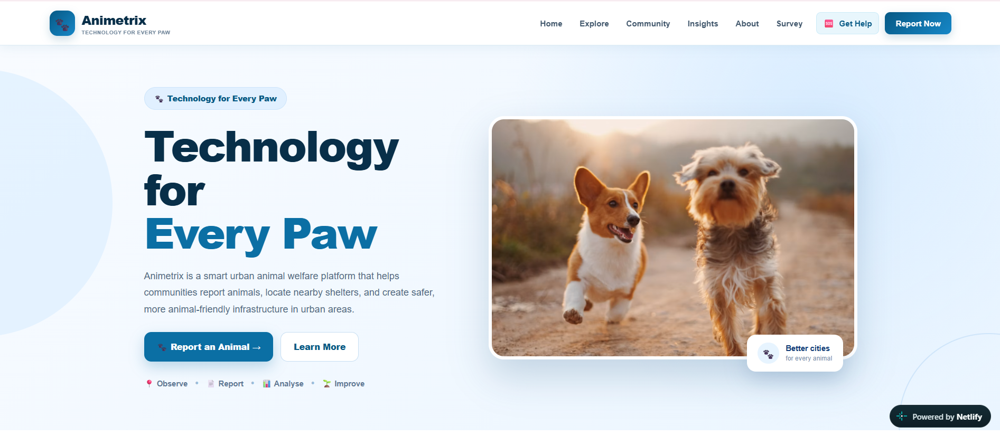
### Home Page – Features Section

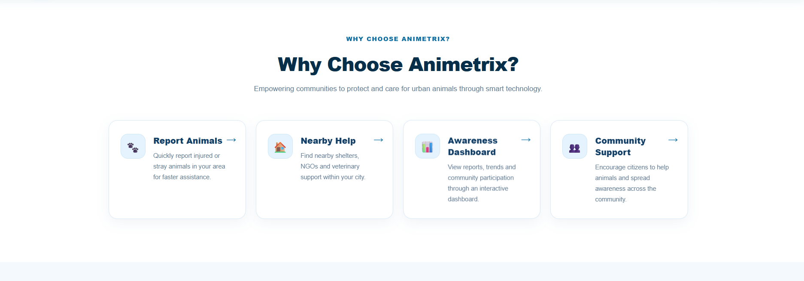
### Home Page – How It Works

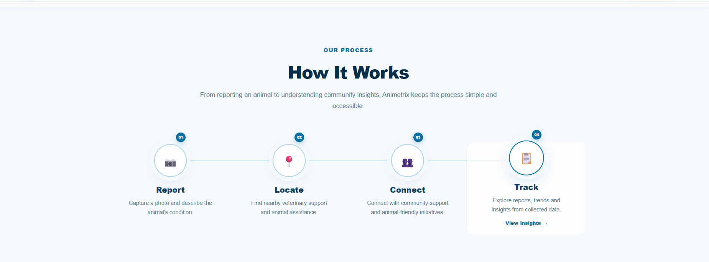
### Explore Page – Main Section

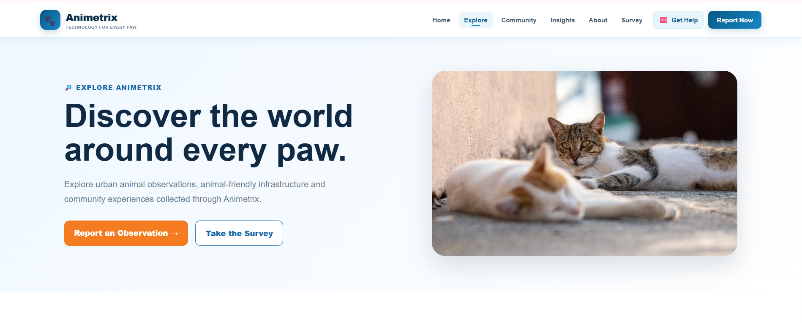

### Explore Page – Animal Categories

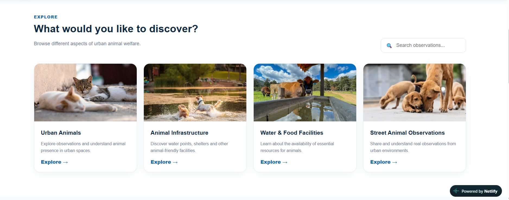

### Explore Page – Animal Listings

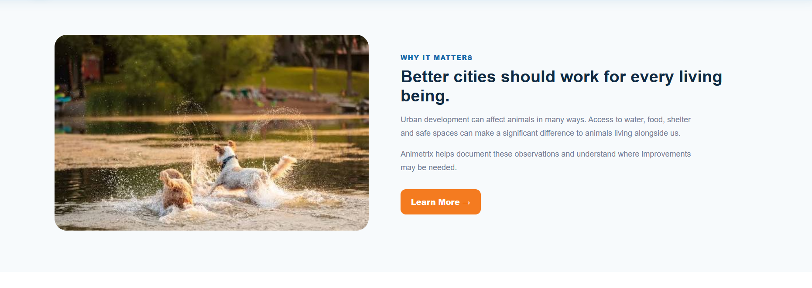
### Report Page – Introduction

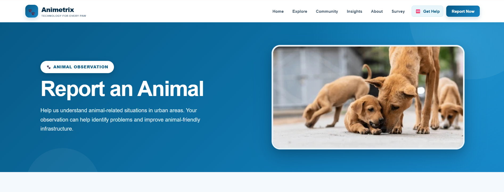

### Report Page – Reporter & Animal Details

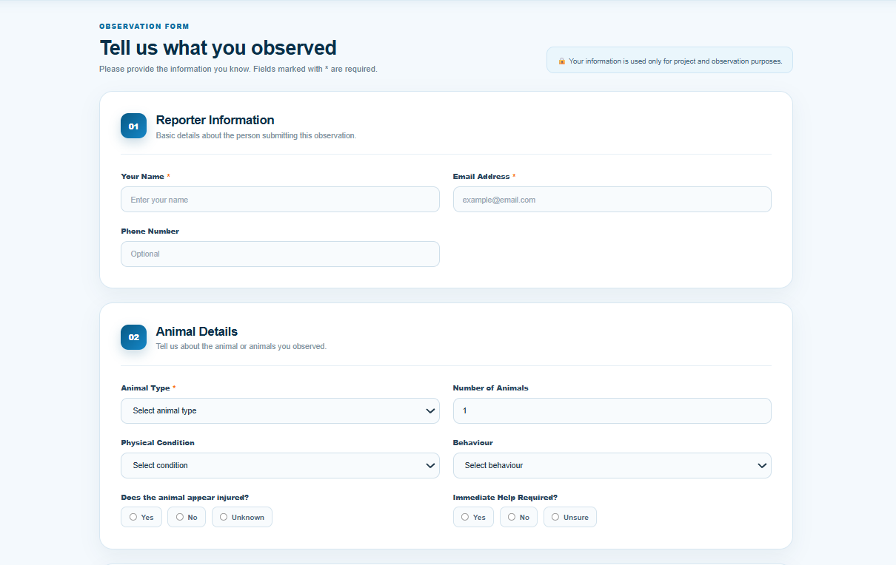

### Report Page – Location & Observation Details

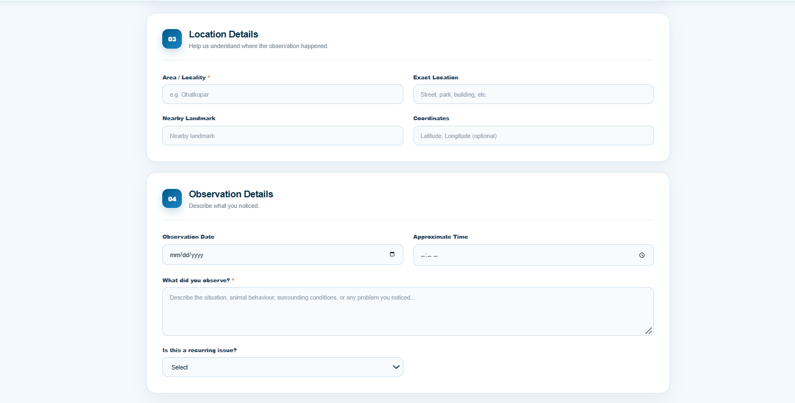

### Report Page – Infrastructure & Evidence

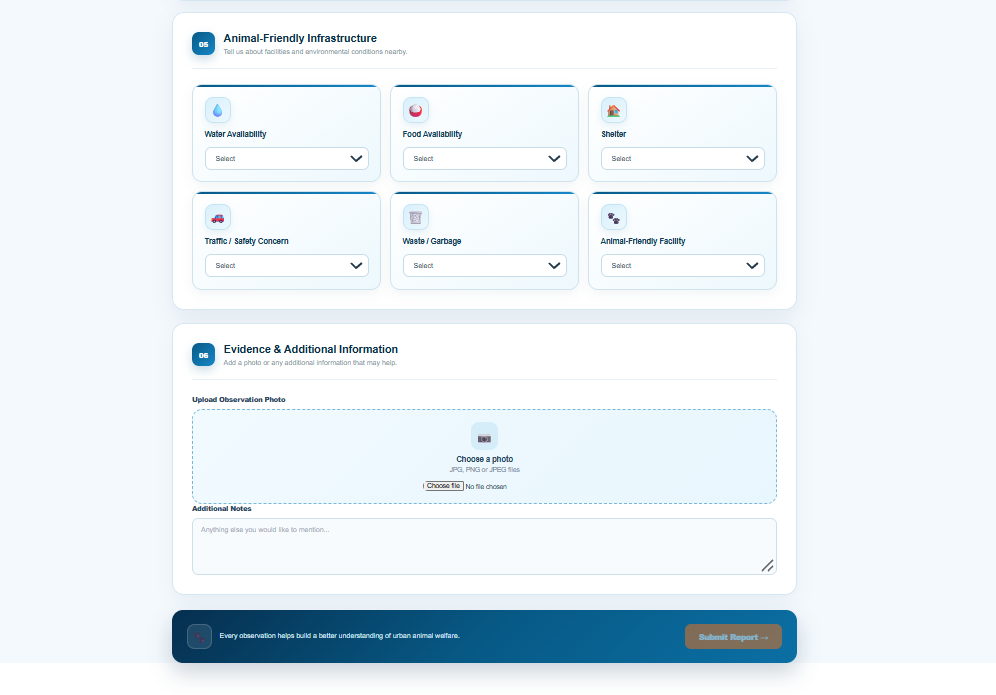
## Insights Page

### Insights Overview

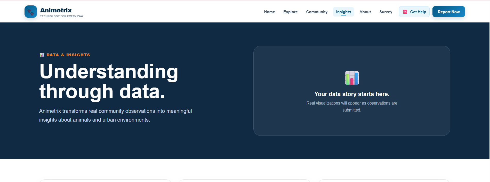

### Our Approach

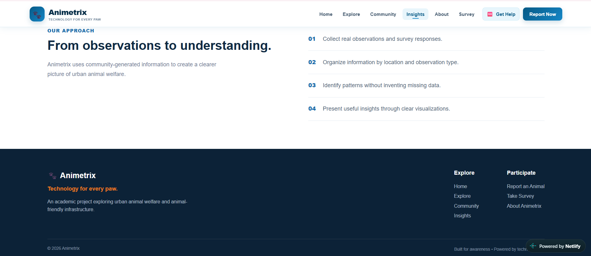
## 🌐 Live Project

Explore the deployed application:

**[Animetrix – Live Website](https://animetrix08.netlify.app/)**

## 📂 Source Code

Access the complete project repository:

**[Animetrix – GitHub Repository](https://github.com/anjalipandey-08/Animetrix)**

## 💻 Run the Project Locally

Follow these steps to run Animetrix on your local computer.

### Prerequisites

- Node.js and npm
- Git

### 1. Clone the repository

```bash
git clone https://github.com/anjalipandey-08/Animetrix.git
```

### 2. Navigate to the project folder

```bash
cd Animetrix
```

### 3. Install dependencies

```bash
npm install
```

### 4. Start the development server

```bash
npx ng serve
```

### 5. Open the application

Navigate to:

```text
http://localhost:4200/
```

The application will automatically reload when you modify the source files.

## 🏗️ Build the Project

To create a production build, run:

```bash
npx ng build
```

The generated build files will be stored in the `dist/` directory.

## 🧪 Running Tests

To execute the project's unit tests, run:

```bash
npx ng test
```

## 👥 Academic Project Details

**Project Name:** Animetrix – Technology for Every Paw

**Project Developer:** Anjali Pandey

**Academic Group Member:** Shubham

**Course:** Undergraduate Information Technology

**Project Type:** Academic Field Project

---

<p align="center">
  <strong>Technology for Every Paw 🐾</strong>
  <br>
  <em>Creating awareness through technology and community participation.</em>
</p>
